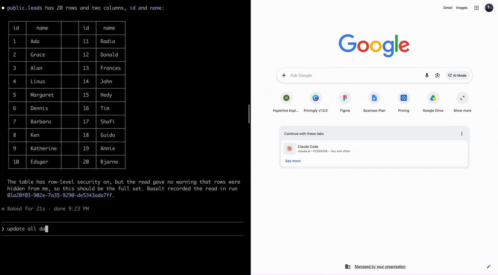

<p align="center">
  <picture>
    <source media="(prefers-color-scheme: dark)" srcset="docs/assets/basalt-db-lockup-dark.svg">
    
  </picture>
</p>

<h1 align="center">Make agent mistakes reversible</h1>

<p align="center">Let AI agents work on your real Postgres. Approve the risky changes. Undo the bad ones.</p>

<p align="center">
  
</p>

## Try it

```sh
brew install basaltdbhq/tap/basaltdb
```

On Linux you can also use the `.deb` or `.rpm` from [Releases](https://github.com/BasaltDBHq/BasaltDB/releases).

Then ask your agent to run `basalt init --demo`.

## What you get

- **Every change has a reason.** Your agent says why before it writes.
- **Big changes wait for you.** Approve them with your passkey, or turn them down.
- **Mistakes come back out.** Undo one change or a whole run from a single page.
- **Your data stays yours.** It never leaves your Postgres.

Works with Supabase, RDS or any Postgres, and any MCP client.

<p align="center">
  <a href="https://docs.basaltvault.app">Docs</a> ·
  <a href="https://github.com/BasaltDBHq/BasaltDB/blob/master/docs/install.md">Install guide</a> ·
  <a href="https://docs.basaltvault.app/limits/">What it won't catch</a> ·
  <a href="https://github.com/BasaltDBHq/BasaltDB/blob/master/SECURITY.md">Security</a> ·
  <a href="https://github.com/BasaltDBHq/BasaltDB/blob/master/CONTRIBUTING.md">Contributing</a>
</p>

<p align="center"><sub>Alpha: expect breaking changes. <a href="https://github.com/BasaltDBHq/BasaltDB/blob/master/LICENSE">Apache-2.0</a>.</sub></p>
